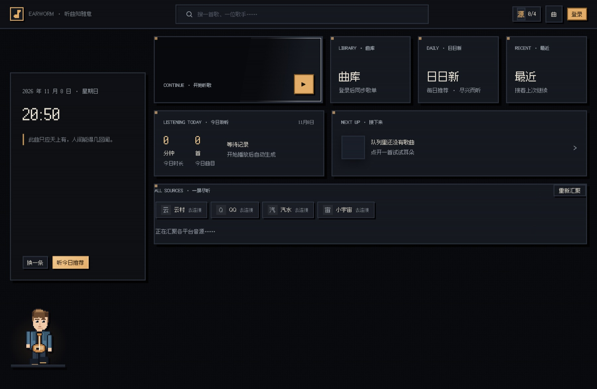
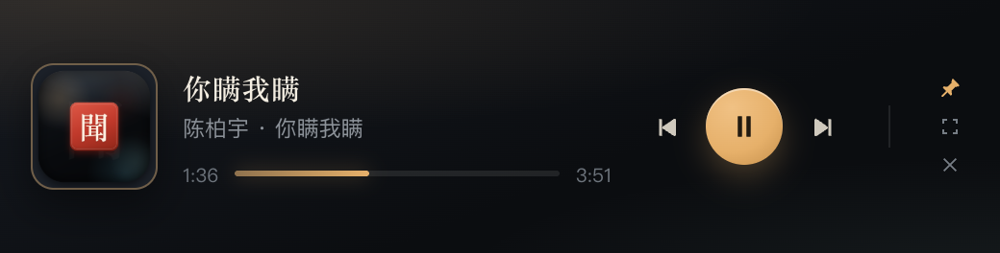
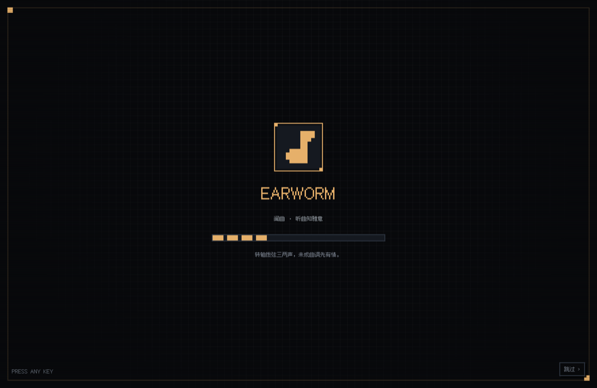

# 闻曲 Earworm · macOS 桌面版

> 听曲知雅意 —— 像素风音乐播放器，原生 macOS 外壳 + 内嵌本地音源服务。

本仓库是 Web 版 [earworm](https://github.com/jibai33/earworm) 的 **macOS 桌面版**，骨架参考
[Mineradio](https://github.com/jibai33/Mineradio-paused)（Electron 桌面播放器），把「浏览器里开一个网页」升级为真正的 Mac 应用：菜单栏常驻、全局媒体键、迷你播放器、系统「正在播放」。







> **只是想用这个播放器？** 直接看下面的 [快速开始](#快速开始使用)，完整图文步骤在
> **[软件操作手册](docs/操作手册.md)**（安装、四平台登录、听歌、彩蛋、快捷键、故障排查）。
> 想改代码 / 打包，再看后面的「开发」章节。

---

## 纯像素风（8-bit）

整套界面是**纯像素风**，不是「国风 + 像素」的混搭：没有印章、没有水墨、没有毛笔大字，
只有方块、实线边框、像素字和一台老机器的屏幕质感。`app/web/pixel.css` 只做覆盖，
不碰业务样式，靠「覆盖设计令牌 + 逐组件重绘」把原来的墨染玻璃整个换掉。

| | 做法 |
|---|---|
| 字体 | Ark Pixel 12（12px 像素字，GB2312 子集，215 KB），字号只用 12 / 24 / 36 / 48，整数倍缩放才不糊 |
| 形状 | 全局 `border-radius: 0`、`backdrop-filter: none`，2px 实线边框 + `3px 3px 0` 硬投影 |
| 色板 | 屏幕黑 `#08090c` / 面板 `#0e1014` / 分隔 `#2b323d` / 琥珀单色高亮 `#e6b06a` |
| 质感 | CRT 扫描线、16px 网点、`image-rendering: pixelated`；去掉所有模糊与柔光渐变 |
| 动效 | 缓动全部换成 `steps()` 阶梯，入场像旧游戏机一格一格跳 |
| 图标 | 应用图标、菜单栏图标、品牌徽章、无封面占位都是同一枚 11×11 像素音符精灵 |

去国风化时具体删掉的东西：`聞` 字印章（顶栏 / 弹窗 / 开机）、卡片角落的巨型装饰字
（册 / 新 / 续）、侧栏的书法水印、朱砂红主色。品牌标记改成「琥珀描边的像素音符徽章」，
红色只保留给危险操作。

### 开机动画：3 秒

纯 CSS 分镜，JS 失效也不会把用户挡在门外：

| 时间 | 画面 |
|---|---|
| 0.00s | 像素网格 + 取景框亮起 |
| 0.16s | 像素音符徽章以 6 级阶梯「推」进画面 |
| 0.66s | 标题 `EARWORM` 以 12 级打字机刷出 |
| 1.30s | 12 格进度条逐格点亮（1.2s） |
| 2.48s | 纯色方块闪一下 |
| 2.80s | 自下而上擦除 |
| **3.02s** | 收场，`#boot` 移除；任意键 / 点击可提前跳过 |

`app/web/boot.js` 里的 `DURATION = 3020` 与 CSS 的 `bootWipe .22s 2.80s` 对应，
改时长要两边一起改。

---

## 与 Web 版的区别

| | Web 版 | macOS 桌面版（本仓库） |
|---|---|---|
| 运行形态 | `node server.js` + 浏览器 | 双击 App，服务进程内嵌，不占端口、不弹浏览器 |
| 播放控制 | 页面内 | 菜单栏 / Dock / 全局媒体键 / 迷你播放器 |
| 汽水扫码登录 | 依赖本机 Chrome + CDP 模拟 | 直接用 Electron `BrowserWindow` 跑官方 SDK，不再需要装 Chrome |
| 凭据 / 听感画像 | 写在工程目录 | 写入 `~/Library/Application Support/闻曲/data`，App 包只读、签名不被破坏 |
| Service Worker | 离线缓存 | 桌面版自动禁用（随 App 更新，避免旧缓存） |
| 窗口 | 浏览器标签 | 原生标题栏（红绿灯内嵌）、全屏、记忆窗口位置、关闭后留在菜单栏 |

前端（`app/web`）与音源服务（`app/server.js`、`app/modules`）与 Web 版同源，
桌面版只新增 `electron/` 一层，不改动任何播放器业务逻辑。

---

## 功能

- **四平台音源**：网易云 / QQ 音乐 / 汽水音乐 / 小宇宙，统一检索与播放（`/api/unified/*`）
- **登录**：网易云扫码、汽水抖音扫码、QQ 三通道扫码（手机 QQ / 微信 / QQ 音乐 App）、小宇宙短信
- **像素风视觉**：8-bit 皮肤 + 3 秒开机动画、方块卡片、扫描线、阶梯动效、黑胶旋转
- **登录彩蛋**：首次登录 / 退出后重登各有一套「输入四字暗号 → 全屏 8-bit 四幕动画」演出，可跳过、可重播
- **已登录账号卡片**：登录后不再显示扫码框，改为头像 / 昵称 / 账号 ID / 状态 / 可用能力与「退出登录」
- **一屏尽听**：多平台曲库、推荐、收藏汇聚到同一屏，登录后无需来回切音源；首页上是两行两列的音源矩阵（每块一条可翻页轨道 + 条数），四平台一眼看全
- **首页听感层**：底部一行两块真数据——今天的唱片墙缩略（当天挂了几张、最近挂的那张亮暖光）+ 本月年鉴摘要（标题 / 三个数字 / 24 小时柱图）；主卡右上角一条与菜单栏同源的 8 段电平，暂停落成基线；左栏补上唱片店 8 格进度与夜间频道入口，不用再绕进曲库
- **回听闭环（v2）**：唱片墙「重播这一天」、年鉴「把这一期做成歌单」、首页「去年今天 · 再听那天」——所有回看动作只有一个出口：按真实播放顺序加入播放队列，队列里带来源角标（同曲只进一次，标 ×N），取不到地址沿用自动跳过
- **今日一曲**：每天 00:00 换一张，从听感画像的方向里挑近 30 天没播过的一首，播过自动盖「已听」章；同一张卡上的「给我一首意外的」白天也能用，不再锁在 0–5 点
- **最近 30 天热度条**：30 个像素方块，越亮听得越多，点任意一天直接跳到那天的唱片墙
- **⌘K 命令面板**：像素终端式，输入即搜歌 / 跳页 / 切模式 / 回放；成就解锁当场给 8-bit 音效 + 菜单栏图标闪一下 +「唱片店 +1」；深夜频道可手动切、自动接管可关并给可撤销提示
- **不可播说清原因**：跳过的歌在队列里标 `VIP 限制 / 版权下架 / 音源未登录 / 音源加载失败`，点一下可再试
- **沉浸播放**：歌词、频谱、音质切换、倍速、评论、播放队列、喜欢、播放模式
- **播不了就跳过**：取不到播放地址（VIP / 版权 / 未登录）先自动换其它平台的同名版本，换源也不成就直接放下一首，不停在报错上；跳过的歌在队列里灰掉并标「不可播」，点一下可再试。播到一半断线的则先原地重连一次，不轻易判死
- **听感画像**：收听 50% / 搜索 30% / 浏览 20% 加权推荐，支持同步码跨端共用（Web / macOS / iOS）
- **菜单栏频谱**：菜单栏图标是 8 段实时频谱（对数分频，暂停落成一条基线）；左键点开锚定面板，右键出菜单
- **深夜频道**：0–5 点自动接管，整套色板切成单色深蓝、亮度降一档，只给慢歌与纯音乐；附「给我一首意外的」——从画像权重最低的方向抽，且近 30 天没播过
- **听觉年鉴**：把事件流印成一张奶油色像素小报，分**年鉴 / 月鉴 / 周鉴**三种尺度（记录保留一年，年鉴看得到去年这个时候）；标题只讲一件具体的事（某天把同一首听了 8 遍 / 某首被连跳 4 次），可「撕下来」存 PNG
- **像素唱片墙**：一天一面墙——当天听过的封面钉在当天的墙上，退出重进都还在，可左右翻回之前每一天；最近挂的那张亮暖光，空位是钉子不是占位符，点一下直接播
- **隐藏唱片店**：彩蛋不再看完就没——每达成一件事抽屉里多一张唱片，8 张全部**真的能播**（16 秒 8-bit 片段由 Web Audio 现场合成，旋律由种子决定）
- **macOS 原生**：
  - 菜单栏实时频谱图标（16px 高，模板图自动适配浅色 / 深色菜单栏）+ 右键菜单（当前曲目 / 播放暂停 / 上下曲 / 迷你播放器）
  - Dock 菜单、系统媒体键（⏯ ⏭ ⏮）、控制中心「正在播放」
  - **迷你播放器**：520×132 悬浮小窗，同样的像素皮肤，带 8 段频谱；「常驻」后失焦不收起
  - 关闭窗口不退出（`Cmd+Q` 才退出），单实例运行

---

## 快速开始使用

### 1. 安装

推荐直接用已构建好的 App：`dist/mac-arm64/闻曲.app`（Apple Silicon）或自己执行
`npm run build:dir` 生成，然后拖进「应用程序」。首次打开若被系统拦截：

```bash
xattr -cr /Applications/闻曲.app
```

或在访达里 **右键 → 打开 → 打开**。源码运行见下方「开发」，环境要求 macOS 11+ / Node 22+。

### 2. 启动

双击 Dock 图标，先看 3 秒像素开机动画（任意键 / 点击可跳过）。
关闭窗口不会退出应用，菜单栏会留一枚像素音符；彻底退出用 `Cmd+Q`。
内嵌音源服务只监听 `127.0.0.1` 的随机端口，不弹浏览器、不对外暴露。

### 3. 连接音源

点右上角「登录」→「音源总览」，按提示逐个连接云村 / 汽水 / QQ / 小宇宙。
每个账号只需授权一次；已连接的平台会显示账号卡片，退出后需重新授权。
扫码类登录要用对应手机 App，汽水用**抖音 App**扫，QQ 音乐可任选手机 QQ / 微信 / QQ 音乐 App 三条通道。

### 4. 开始听

顶栏搜索框输入歌名或歌手（可切「全部音源」或单平台），点结果即播；
也可以点首页「听今日推荐」或直接点「继续听」大卡片。
底部播放条可切歌、调音量、看队列；点 `⌃` 展开沉浸播放页看歌词、切音质、写评论。

> 完整步骤、四平台登录细节、彩蛋玩法、快捷键与故障排查见 **[软件操作手册](docs/操作手册.md)**。

---

## 开发

```bash
npm install
npm start          # 启动桌面版
npm run dev        # 启动并打开开发者工具
npm run server     # 只跑本地音源服务（浏览器访问 http://localhost:3210/app/）
```

环境：macOS 11+、Node 22+。

### 调试

```bash
EARWORM_DEV=1 npx electron .            # 打开 DevTools
EARWORM_REMOTE_DEBUG=9222 npx electron . # 暴露 DevTools 协议端口（可接 puppeteer）
```

### 与 Web 版的关系

**两端完全独立。** 本仓库自带完整的服务端与前端（`app/server.js`、`app/modules`、`app/web`），
不依赖也不引用 `earworm` 仓库的任何文件，两边各自演进、互不覆盖：

- 桌面端为了写数据到 `~/Library/Application Support/闻曲`、绕过只读 App 包等原因，对路径做了本仓库内的改造；
- 因此**不要**用 `rsync` / 复制的方式从 Web 仓库覆盖 `app/`，那会把桌面端的改动冲掉；
- 需要借鉴 Web 端的某个具体实现时，手动挑那一段改过来即可，不做整体同步。

### 目录结构

```
electron/             # macOS 外壳（新增）
  main.js             #   主进程：内嵌服务、窗口、托盘、媒体键、IPC
  tray-icon.js        #   菜单栏 8 段频谱的位图绘制（模板图，18pt）
  menu.js             #   系统菜单栏
  preload.js          #   注入桌面版外观 / 采集播放状态与频谱 / 系统「正在播放」
  mini.html           #   迷你播放器（独立无边框窗口）
  mini-preload.js
  mac-chrome.css      #   红绿灯让位与拖拽区（仅桌面版注入）
app/                  # 与 Web 版同源
  server.js           #   本地音源服务（HTTP，仅监听 127.0.0.1）
  modules/            #   网易云 / QQ / 汽水 / 小宇宙 / 画像 / 推荐
    night.js          #     深夜频道：慢歌筛选 + 反画像抽曲
    crate.js          #     隐藏唱片店：按事实推导解锁状态
    event-time.js     #     事件发生时间 / 日 / 周 / 月窗口（统计口径统一在这里）
    wall.js           #     唱片墙：按「天」聚合事件流
    yearbook.js       #     听觉年鉴：按年 / 月 / 周找「具体的那件事」
  web/                #   原生 HTML/CSS/JS 前端
    pixel.css         #     像素皮肤（只覆盖，不改业务样式）
    night.css/.js     #     深夜频道页面与时段接管
    crate.css/.js     #     唱片店页面 + 8-bit 现场合成
    wall.css/.js      #     唱片墙
    yearbook.css/.js  #     像素小报 + PNG 导出
    home-extra.css/.js#     首页听感层（墙面缩略 / 年鉴摘要 / 电平条 / 左栏进度）
    fonts/            #     Ark Pixel 12 像素字体（GB2312 子集）
  user-paths.js       #   可写目录解析（桌面版指向 Application Support）
scripts/make-icons.js # 生成像素风 icon.icns 与菜单栏模板图标
build/                # 图标、entitlements
```

### 打包

```bash
npm run icons      # 重新生成图标（需要本机 Chrome）
npm run build:mac  # 产出 dist/*.dmg 与 *.zip（arm64 + x64）
npm run build:dir  # 只产出 dist/mac*/闻曲.app，便于本地验证
npm run build:dir:offline  # 网络不稳时用本地 electron 副本打包（-c.electronDist）
```

未配置签名证书时，首次打开需右键 →「打开」，或执行：

```bash
xattr -dr com.apple.quarantine /Applications/闻曲.app
```

---

## 快捷键

| 操作 | 快捷键 |
|---|---|
| 播放 / 暂停 | 菜单栏「播放」，或系统媒体键 |
| 上一首 / 下一首 | `Cmd+←` / `Cmd+→`，或媒体键 |
| 喜欢当前曲目 | `Cmd+L` |
| 音量 ± | `Cmd+↑` / `Cmd+↓` |
| 静音 | `Cmd+Alt+M` |
| 搜索 | `Cmd+F` |
| 命令面板（搜歌 / 跳页 / 回放） | `Cmd+K` |
| 首页 / 曲库 | `Cmd+1` / `Cmd+2` |
| 播放队列 | `Cmd+U` |
| 迷你播放器 | `Cmd+Shift+M` |
| 唤回主窗口 | `Cmd+Shift+O` |
| 偏好设置 | `Cmd+,` |
| 退出应用 | `Cmd+Q` |
| 彩蛋随时跳过 | `Esc` |

完整菜单与逐项说明见 [操作手册 · 快捷键](docs/操作手册.md#快捷键与菜单)。

---

## 数据与隐私

| 内容 | 位置 |
|---|---|
| 登录凭据（网易云 / QQ / 汽水 / 小宇宙） | `~/Library/Application Support/闻曲/data/` |
| 听感画像 `taste-profiles.json` | 同上 |
| 登录彩蛋状态 `.login-egg.json` | 同上（是否首次登录、已解锁彩蛋） |
| 窗口位置 | `~/Library/Application Support/闻曲/window-state.json` |
| 迷你播放器位置 | `~/Library/Application Support/闻曲/mini-state.json` |

所有凭据仅保存在本机，不上传任何服务器。听感画像只在你自己填了同一个同步码的设备之间共享。

---

## 文档

| 文档 | 内容 |
|---|---|
| [软件操作手册](docs/操作手册.md) | 面向使用者：安装、界面导览、四平台登录、听歌、彩蛋、快捷键、故障排查 |
| [v2 整体设计方案](docs/mockups/design-v2-00-overview.png) | 信息架构、首页重构、回听闭环、细节规范四张画板（另有 01/02/03 同目录） |
| 本 README | 项目简介、功能、开发、打包、数据位置 |

---

## 许可

GPL-3.0-only。播放器骨架与部分登录实现衍生自 [Mineradio](https://github.com/jibai33/Mineradio-paused)，
音源接口来自 `NeteaseCloudMusicApi` 与各平台公开 Web API。仅供个人学习与自用。
