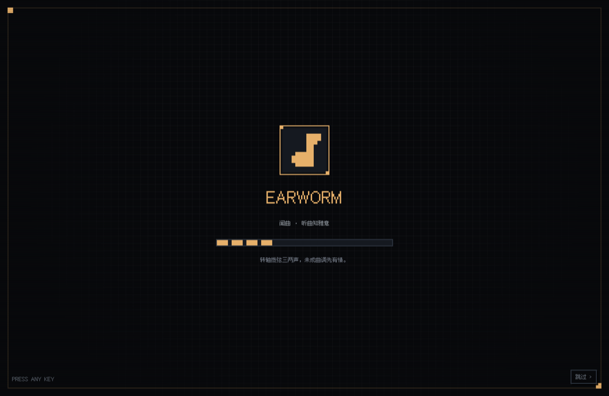
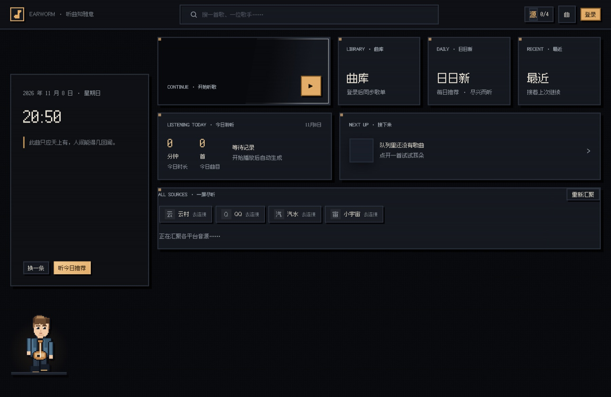
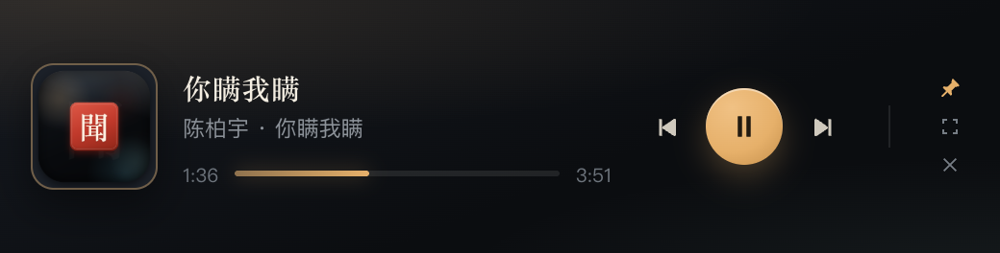

# 闻曲 Earworm · 软件操作手册

> 适用版本：macOS 桌面版（`earworm_mac`，2026-11 及之后）
> 面向使用者：不写代码也能照着做完安装、登录、听歌、彩蛋与日常排障。
> 开发 / 打包 / 目录结构请看仓库根目录的 [README](../README.md)。

---

## 目录

1. [安装与启动](#安装与启动)
2. [界面导览](#界面导览)
3. [登录与账号管理](#登录与账号管理)
4. [听歌全流程](#听歌全流程)
5. [每日推荐与听感画像](#每日推荐与听感画像)
6. [登录彩蛋](#登录彩蛋)
7. [快捷键与菜单](#快捷键与菜单)
8. [常见问题排查](#常见问题排查)
9. [数据与隐私](#数据与隐私)

---

## 安装与启动

### 安装

| 方式 | 步骤 |
|---|---|
| 已构建 App（推荐） | 取 `dist/mac-arm64/闻曲.app`，拖进「应用程序」；Apple Silicon 机型直接用这个 |
| 自行打包 | 仓库根目录执行 `npm install` → `npm run build:dir`（或 `npm run build:dir:offline`），产物在 `dist/mac-arm64/` |
| 源码直接跑 | `npm install` → `npm start`；开发调试用 `npm run dev` |

环境：macOS 11+、Node 22+（仅源码运行 / 打包时需要）。

**首次打开被系统拦下**（提示「已损坏」或「无法验证开发者」）：

```bash
xattr -cr /Applications/闻曲.app
```

或在访达里对 App **右键 → 打开 → 打开**。这是因为未配置 Apple 签名证书，不是文件损坏。



### 启动后的三件事

1. 双击 Dock 图标，先播放约 3 秒的像素开机动画，**按任意键或点一下即可跳过**。
2. 关掉窗口 **不会退出应用**，菜单栏右侧会留一枚像素音符图标，点它能切歌、开迷你播放器；彻底退出用 `Cmd+Q`。
3. 音源服务在 App 内部启动，只监听 `127.0.0.1` 的随机端口，不会弹浏览器、不占用对外端口。

---

## 界面导览



### 顶栏

| 元素 | 作用 |
|---|---|
| 左侧像素音符徽标 | 回首页 |
| 中间搜索框 | 搜歌名 / 歌手；`Cmd+F` 直接聚焦 |
| 「源 4/4」 | 已连接音源数，点开可切单平台检索 |
| 「曲」 | 跳到曲库页 |
| 右上角头像 /「登录」 | 打开登录弹窗 |

### 发现页（首页）

左侧时间面板显示日期、时钟与一句诗；「换一条」换诗句，「听今日推荐」直接开播。

右侧卡片从上到下：

| 卡片 | 点进去做什么 |
|---|---|
| **继续听 / 开始听歌** | 大卡片显示上次播放或今日推荐，点橙色播放键立即播放 |
| **曲库** | 查看已连接平台的歌单、收藏、订阅 |
| **日日新** | 每日推荐歌单 |
| **最近** | 接着上次播放继续 |
| **今日聆听** | 今日时长、曲目数、最近一首（播放后自动累计） |
| **接下来** | 展开播放队列，看下一首 |
| **为你读谱** | 按听感画像生成的横向推荐，「换一首」刷新 |
| **拾遗** | 三张推荐歌单，点开可「全部播放」 |
| **一屏尽听** | 四平台内容汇聚，登录后自动出现，可「重新汇聚」 |

### 底部播放条与沉浸播放页

底部条：封面、歌名、喜欢 ♡、上一首 / 播放暂停 / 下一首、展开 `⌃`、播放模式、队列 ☰、歌词「词」、音量、时间。

点 `⌃`（或封面区）进入**沉浸播放页**：黑胶封面、滚动歌词、频谱、进度拖拽、倍速、评论、音质、喜欢、切歌、播放模式、队列。点右下 `⌄` 收起。



**迷你播放器**：`Cmd+Shift+M` 呼出 520×132 悬浮小窗，可置顶、拖进度、双击回主窗；`Cmd+Shift+O` 唤回主窗口。

---

## 登录与账号管理

点右上角「登录」打开弹窗，共 5 个标签页。

### 音源总览

一次看清四个平台的连接状态，点「连接下一个音源」自动跳到还没登录的那个；「重新检测」刷新状态。每个账号只需授权一次，之后曲库、推荐、搜索自动汇聚。

### 四个平台怎么登

| 平台 | 步骤 |
|---|---|
| **云村（网易云）** | 打开「云村」标签 → 用网易云音乐 App 扫二维码 → 手机点确认；二维码过期点「刷新二维码」 |
| **汽水音乐** | 打开「汽水」标签 → 点「生成 / 刷新二维码」→ 用**抖音 App** 扫码并在手机确认 → 状态显示「登录成功，凭据已存到本机」。扫不了就展开「手动粘贴 cookie」 |
| **QQ 音乐** | 打开「QQ」标签 → 任选「手机 QQ / 微信 / QQ 音乐 App」通道 → 扫码确认；页面会额外显示 VIP 播放授权状态。也可手动粘贴含 `uin` 与 `qm_keyst` 的 cookie |
| **小宇宙** | 打开「小宇宙」标签 → 选区号、填手机号 →「获取验证码」→ 填短信码 →「登录并保存」。若提示需人机验证，点「去官网获取验证码 ↗」在官网发码，回来填码即可 |

> 小宇宙是播客平台，节目与单集同样会出现在统一搜索与曲库里。

### 已登录之后

**已连接的平台不再显示扫码框**，换成账号卡片：头像 / 昵称、账号 ID、账号状态、登录方式、可用能力标签。

卡片上的按钮：

| 按钮 | 作用 |
|---|---|
| 刷新状态 | 重新拉取账号信息与 VIP / 授权状态 |
| 彩蛋 · 初次相遇 / 彩蛋 · 久别重逢 | 不退出账号也能重播两套彩蛋 |
| 退出登录 | 清除本机该平台凭据，回到扫码 / 表单态 |

凭据过期或想换账号时，先「退出登录」再重新授权即可；重新登录会触发一枚「久别重逢」彩蛋。

---

## 听歌全流程

1. **找歌**：顶栏搜索框输入歌名 / 歌手 → 回车或点结果。默认「全部音源」，也能切「云村 / 汽水 / QQ / 小宇宙」单平台；全域检索时会逐个平台回报「有结果 / 待连接 / 出错」。
2. **播放**：点任一结果即播；底部条出现，首页「继续听」同步更新。结果太多点「再听一页」翻页。
3. **切歌 / 循环**：`⏮` `⏭` 或媒体键；播放模式按钮按顺序 → 单曲循环 ⟳ → 随机 ⤨ 循环切换。
4. **看歌词**：底部条「词」或沉浸页自动显示滚动歌词。
5. **音质**：沉浸页 `♪` 打开菜单，标准 / 极高 / 无损 / Hi-Res；切换后按当前曲目重新取流。无损与 Hi-Res 需要对应平台账号权限。
6. **倍速**：沉浸页 `1×` 按钮依次切 1 → 1.25 → 1.5 → 2 → 0.75。
7. **评论**：沉浸页 💬 打开热评抽屉。
8. **队列**：☰ 或 `Cmd+U` 打开队列，点任意一首直接跳转。
9. **喜欢**：♡ 或 `Cmd+L`（红心目前仅网易云曲目可用，需已登录网易云）。
10. **音量**：底部条滑块，或 `Cmd+↑` / `Cmd+↓`，`Cmd+Alt+M` 静音。

歌单 / 专辑点开后进详情页，可「全部播放」，左上角 ← 返回。

---

## 每日推荐与听感画像

- 首页「听今日推荐」一键播放当日推荐；「日日新」卡片看完整歌单。
- 搜索框**空态**会显示「知音 · 为你而鸣」：听感信号、主推曲目、推荐卡片与列表，可「换一批」或「偏好设置」。
- 画像按 **收听 50% / 搜索 30% / 浏览 20%** 加权生成，每小时更新一次。
- 「偏好设置」里能：查看 / 复制 / 更换同步码、输入另一台设备的 `EW-XXXX-XXXX-XXXX` 绑定并合并画像、开关记录、导出数据、清除记录。
- 不想被记录可点「关闭个性化」，画像不再累计。

---

## 登录彩蛋

登录成功后会有一枚彩蛋：**输入四个字 → 全屏 8-bit 四幕动画**。彩蛋是庆祝层，不拦登录，随时可跳过。

| | 初次相遇 | 久别重逢 |
|---|---|---|
| 触发 | 本机第一次登录任意账号 | 退出登录后再次登录 |
| 谜面 | 天下无战事，人间皆安好。 | 久别之后，开口的第一句话。 |
| 画面 | 星空、带环行星、传送门展开、像素小人、礼花 | 大月亮、亮灯小屋、唱片机、萤火星雨、挥手小人 |
| 落版 | 初次见面，这里是闻曲 | 欢迎回来，位置还留着 |

**怎么玩**

1. 彩蛋弹出后是全屏像素场景 + 中央暗号门，点像素眼睛 `◉` 或「给点提示」看谜面。
2. 在四个格子里输入四个字，回车或点「确认 →」。中文输入法逐字上屏也能正常识别。
3. 答错 2 次给首字提示、3 次给前两字；答案只在服务端校验，前端拿不到明文。
4. 解锁后进入四幕动画（约 7 秒）：顶部四段进度条、幕间打字机字幕、高潮白闪与镜头抖动、落版大标题。
5. `Esc` 或右上角「跳过 · ESC」随时结束；落版可「↺ 再看一次」或「继续听歌 →」。

**不想真的退出账号**：登录弹窗 → 任一已登录平台的账号卡片 →「彩蛋 · 初次相遇 / 彩蛋 · 久别重逢」即可重播。

<details>
<summary>剧透：两枚暗号（不想被剧透就别展开）</summary>

- 初次相遇：`世界和平`（与参考项目 Mineradio 开机愿望同一句）
- 久别重逢：`好久不见`

</details>

彩蛋状态（是否首次登录、已解锁记录）存在 `~/Library/Application Support/闻曲/data/.login-egg.json`。

---

## 快捷键与菜单

| 操作 | 快捷键 |
|---|---|
| 播放 / 暂停 | 菜单栏「播放」，或系统媒体键 ⏯ |
| 上一首 / 下一首 | `Cmd+←` / `Cmd+→`，或媒体键 |
| 喜欢当前曲目 | `Cmd+L` |
| 音量 + / − | `Cmd+↑` / `Cmd+↓` |
| 静音 | `Cmd+Alt+M` |
| 播放队列 | `Cmd+U` |
| 搜索 | `Cmd+F` |
| 首页 / 曲库 | `Cmd+1` / `Cmd+2` |
| 迷你播放器 | `Cmd+Shift+M` |
| 唤回主窗口 | `Cmd+Shift+O` |
| 偏好设置 | `Cmd+,` |
| 退出应用 | `Cmd+Q` |
| 跳过彩蛋 | `Esc` |

菜单栏「播放」里还有播放 / 暂停、上下曲、喜欢、音量、队列；「视图」里可切首页 / 搜索 / 曲库、迷你播放器、主窗口、全屏与缩放；Dock 右键菜单提供当前曲目与常用播放控制。系统控制中心「正在播放」也会显示当前曲目。

---

## 常见问题排查

| 现象 | 处理 |
|---|---|
| 首次打开提示「已损坏」 | `xattr -cr /Applications/闻曲.app`，或右键 → 打开 |
| 二维码一直不出现 / 提示过期 | 点「生成 / 刷新二维码」；每张码有时效，旧码扫过就作废，务必用新码 |
| 手机已确认，本机仍显示未登录 | 刷新二维码重新扫一次；若仍不行，展开对应平台的「手动粘贴 cookie」兜底，界面会显示失败原因 |
| 汽水扫码没反应 | 汽水通道要用**抖音 App** 扫，不是汽水 App；确认后等待 1–2 秒让本机写入凭据 |
| QQ 音乐 VIP / 无损放不了 | 确认账号卡片里 VIP 授权状态；必要时退出后用手机 QQ / 微信通道重新扫码，或手动粘贴含 `uin`、`qm_keyst` 的 cookie |
| 小宇宙发码提示人机验证 | 点「去官网获取验证码 ↗」在官网完成滑块，收到短信后回来填码 |
| 凭据过期 / 想换号 | 账号卡片「退出登录」→ 重新授权 |
| 搜索某平台无结果 | 看搜索页顶部的逐平台回报，标「待连接」的先去登录；标「出错」的多为临时网络问题，稍后重试 |
| 封面空白 / 图片没加载 | 多为音源侧图片防盗链或临时网络失败，不影响播放；可「重新汇聚」或重启应用 |
| 没有声音 | 检查系统音量、底部条音量滑块与 `Cmd+Alt+M` 静音状态 |
| 窗口找不到了 | 点菜单栏像素音符，或 `Cmd+Shift+O` 唤回主窗口 |
| 应用像卡住了 | `Cmd+Q` 彻底退出后重新打开；仍异常可在「视图」菜单里「强制重新载入」 |
| 登录态、彩蛋、画像全想清零 | 退出应用后删除 `~/Library/Application Support/闻曲/data/` 下对应文件（见下节），下次启动会重新生成 |

---

## 数据与隐私

所有数据都写在 `~/Library/Application Support/闻曲/`，**凭据只留本机，不上传任何服务器**。

| 文件 | 内容 |
|---|---|
| `data/.cookie` | 网易云凭据 |
| `data/.qishui-cookie`、`.qishui-qr-login.json` | 汽水凭据与扫码状态 |
| `data/.qq-cookie` | QQ 音乐凭据 |
| `data/.xy-token.json` | 小宇宙凭据 |
| `data/taste-profiles.json` | 听感画像 |
| `data/.login-egg.json` | 登录彩蛋状态 |
| `window-state.json` / `mini-state.json` | 主窗口 / 迷你播放器位置 |

卸载：退出应用 → 把 `/Applications/闻曲.app` 移到废纸篓 → 按需删除上面整个 `~/Library/Application Support/闻曲/` 目录（会一并清掉登录凭据与画像，请先备份）。

---

许可 GPL-3.0-only，仅供个人学习与自用。问题与建议请提到仓库 Issues。
